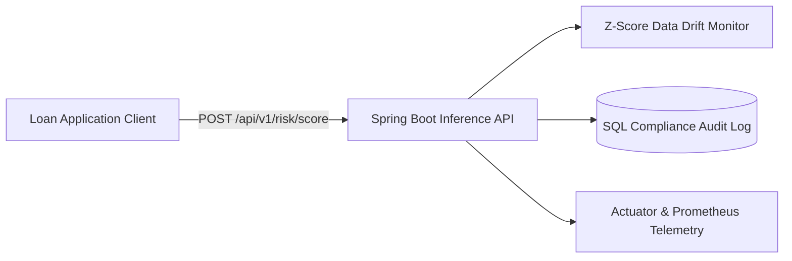

# MLOps Credit Risk Serving & Drift Monitoring Platform

A production-style **Java 17 & Spring Boot** ML inference gateway trained around the **UCI German Credit Dataset**, featuring real-time and CSV batch scoring, SQL compliance audit trails, Z-score data drift detection, and **Prometheus/Actuator** observability.

## Architecture



## Key Features & Endpoints
* **`POST /api/v1/risk/score`** — Real-time JSON credit risk scoring with Jakarta Bean Validation.
* **`POST /api/v1/risk/score/batch`** — Bulk CSV scoring (`data/german_credit_sample.csv`).
* **`GET /api/v1/risk/audit`** — Full historical prediction audit trail for banking compliance.
* **`GET /api/v1/risk/drift-alerts`** — Lists loan requests flagged for statistical feature drift (`Z-score > 2.0`).
* **`GET /actuator/prometheus`** — Live inference latency timers and drift alert counters.

## Tech Stack
* **Backend:** Java 17, Spring Boot 3.5, Spring Web, Jakarta Validation
* **Database:** Spring Data JPA, Embedded H2 SQL
* **Observability & DevOps:** Spring Boot Actuator, Micrometer, Prometheus, JUnit 5, Docker, GitHub Actions

## Quick Start

### 1. Run Tests & Build
```bash
mvn clean package
```

### 2. Sample Scoring Request
```bash
curl -X POST http://localhost:8080/api/v1/risk/score \
  -H "Content-Type: application/json" \
  -d '{
    "applicationId": "APP-2001",
    "checkingStatus": "A11",
    "durationMonths": 36,
    "creditHistory": "A32",
    "creditAmount": 8500.0,
    "age": 24
  }'
```
